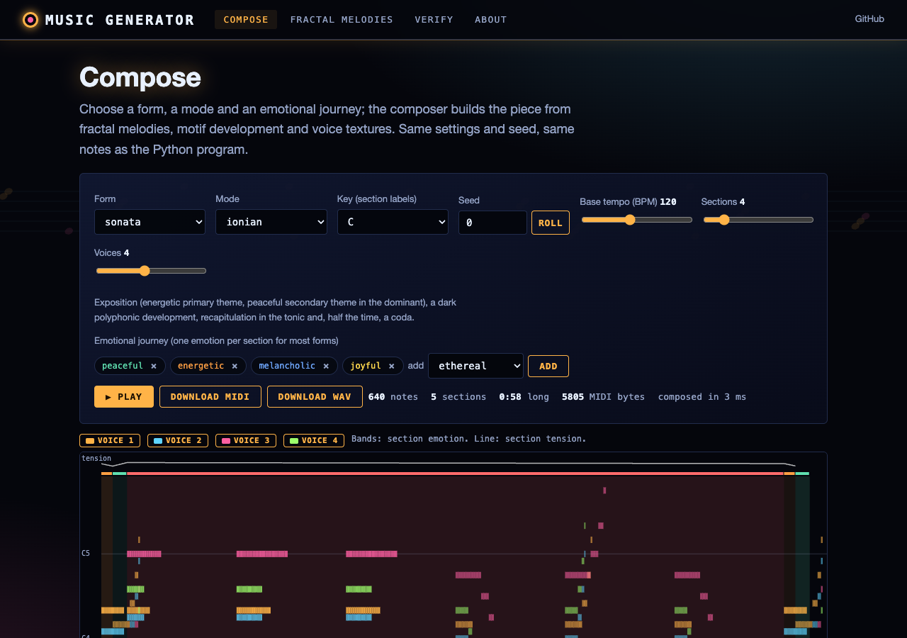
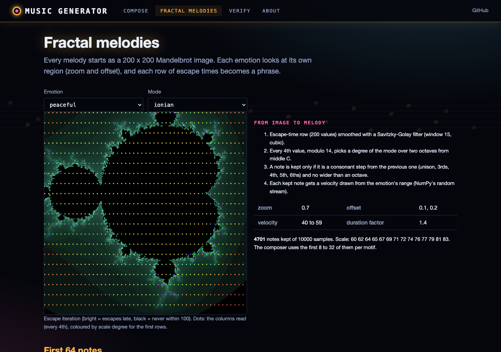
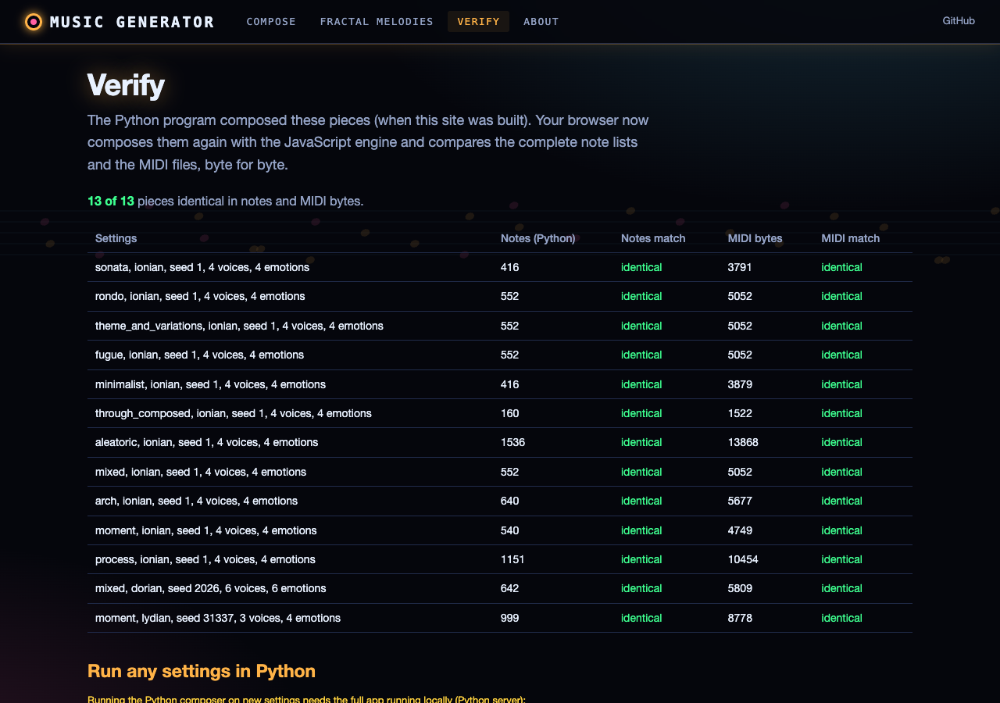

# Creative Music Generator

A sophisticated algorithmic composition system that combines fractal patterns, musical genetics, and advanced form structures to create complex musical compositions.

## Overview

This project implements a creative music generation system that uses multiple algorithmic approaches to create musical compositions. It combines:

- Fractal-based melody generation
- Advanced musical form structures
- Genetic algorithms for musical development
- Sophisticated harmony generation
- Multiple texture types and voice leading
- Visualization tools for musical analysis

## Components

The project consists of several Python modules:

### advanced_composer.py
The main composition engine that orchestrates all components and implements various musical forms including:
- Sonata form
- Arch form (ABCBA structure)
- Moment form (Stockhausen-inspired)
- Process music (Reich/Glass-inspired)
- Minimalist
- Aleatoric
- Through-composed

### fractal_melody_generator.py
Generates melodies using fractal patterns (Mandelbrot set) with:
- Multiple musical modes
- Emotional styling
- Pitch-to-scale mapping
- Dynamic and articulation control

### harmony_engine.py
Handles harmonic progression with:
- Voice leading optimization
- Multiple harmony styles (Classical, Jazz, Modal)
- Chord voicing generation
- Consonance/dissonance control

### musical_genetics.py
Implements genetic algorithms for musical development:
- Motif evolution
- Fitness evaluation
- Musical crossover and mutation
- Population management

### multi_fractal_music.py
Extends fractal generation to multiple musical parameters:
- Multiple fractal types (Mandelbrot, Julia, Koch, etc.)
- Independent control of melody, harmony, and rhythm
- Sophisticated visualization tools

## Installation

1. Clone the repository:
```bash
git clone https://github.com/gddickinson/music-generator.git
cd music-generator
```

2. Install required dependencies:
```bash
pip install -r requirements.txt
```

## Usage

Basic usage:

```python
from advanced_composer import CreativeComposer, CreativeComposerParams, MusicalForm, MusicalMode, EmotionalStyle

# Create composer parameters
params = CreativeComposerParams(
    form=MusicalForm.PROCESS,  # Choose musical form
    base_tempo=100,
    key="C",
    mode=MusicalMode.IONIAN,
    emotional_journey=[
        EmotionalStyle.PEACEFUL,
        EmotionalStyle.ENERGETIC,
        EmotionalStyle.MELANCHOLIC,
        EmotionalStyle.DARK,
        EmotionalStyle.ETHEREAL,
        EmotionalStyle.JOYFUL
    ],
    section_count=8,
    voice_count=4,
    visualization_enabled=True
)

# Create composer and generate composition
composer = CreativeComposer(params)
midi, audio = composer.generate_composition()

# Save the composition
composer.save_composition(midi, audio, "my_composition")
```

## Web interface

**Live site:** https://gddickinson.github.io/music-generator/ (published from `main` by GitHub Actions)

The composer runs in the browser: `advanced_composer.py` and `fractal_melody_generator.py` are ported to JavaScript
(`web/static/composer_engine.js` and friends), together with CPython's `random`, NumPy's legacy random generator and
MIDIUtil's writer, so the same settings and seed give **the same notes and the same MIDI bytes** as the Python
(checked by a node test on 28 pieces and live on the Verify page).

- **Compose**: form, mode, key, tempo, sections, voices, seed and the emotional journey; piano roll with section
  emotions and tension, playback (WebAudio, after a click), MIDI download (identical to the Python file), WAV rendered
  in the browser, and the Python snippet that reproduces the piece.
- **Fractal melodies**: the Mandelbrot region each emotion reads and the melody it yields.
- **Verify**: pieces composed by the Python program compared with the browser engine; the local app can also run the
  Python on any settings.

| Compose | Fractal melodies | Verify |
|---|---|---|
|  |  |  |

### Run the web app

```bash
pip install -r requirements-web.txt
python run_web.py                 # http://127.0.0.1:8166
python -m pytest -q tests/        # web, regression and JS-vs-Python checks (needs node for the JS tests)
python scripts/build_static.py    # static site in site/
```

To reproduce a piece from the site in Python, seed both generators before building the composer
(`random.seed(s); np.random.seed(s)`); the Compose page shows the exact snippet. Python 3.12 or later is needed for
bit-identical timing (its `sum()` is compensated). `scripts/make_fixtures.py` regenerates the JS test fixtures.

## Musical Theory and Implementation

### Fractal Melody Generation
The system uses fractal patterns to generate melodies by:
1. Generating a Mandelbrot set
2. Mapping fractal values to musical scales
3. Applying emotional parameters
4. Creating coherent melodic contours

### Musical Forms
Implements various musical forms including:

#### Sonata Form
- Exposition (Primary and Secondary themes)
- Development
- Recapitulation
- Optional Coda

#### Arch Form (ABCBA)
- Palindromic structure
- Gradual build-up to climax
- Symmetric return

#### Process Music
- Gradual transformation
- Phase shifting
- Additive processes
- Textural evolution

#### Moment Form
- Independent sections
- Non-linear structure
- Contrasting materials
- Abrupt transitions

### Voice Leading and Harmony
- Implements traditional voice leading rules
- Avoids parallel fifths/octaves
- Maintains proper spacing
- Controls voice crossing

### Genetic Development
Uses genetic algorithms for:
- Motif development
- Phrase evolution
- Form generation
- Style adaptation

## Visualization

The system generates various visualizations:
- Form structure graphs
- Tension graphs
- Voice leading analysis
- Harmonic progression visualization

## Output Formats

- MIDI files (.mid), from all three entry points
- WAV audio (.wav) from `main_composer.py` (`generate_wav=True`) and `multi_fractal_music.py`;
  `CreativeComposer` (`advanced_composer.py`) writes MIDI only and rejects `generate_wav=True`
- Visualization images (.png)

## Examples

The repository includes one example output of `advanced_composer.py` (arch form):
`creative_composition.mid`, with its `form_structure.png` and `tension_graph.png`.

## Contributing

Contributions are welcome: please open an issue or a pull request.

## License

This project is licensed under the MIT License - see the `LICENSE` file for details.

## Acknowledgments

- Special thanks to the music theory and algorithmic composition community
- Inspired by works of Steve Reich, Karlheinz Stockhausen, and György Ligeti
- Built using various Python scientific computing libraries

## Future Development

Planned features:
- Additional musical forms
- More sophisticated genetic algorithms
- Enhanced visualization tools
- Real-time MIDI output
- Machine learning integration
- Web interface for parameter control

## Citation

If you use this project in your research, please cite:
```
@software{creative_music_generator,
  title = {Creative Music Generator},
  author = {Dickinson, George},
  year = {2025},
  url = {https://github.com/gddickinson/music-generator}
}
```

---
*Built with AI assistance from [Claude (Anthropic)](https://claude.com/).*
